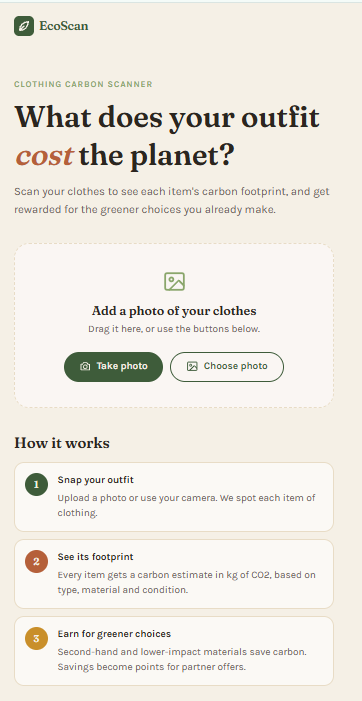
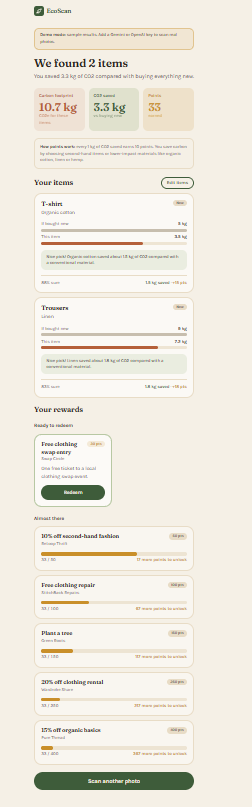
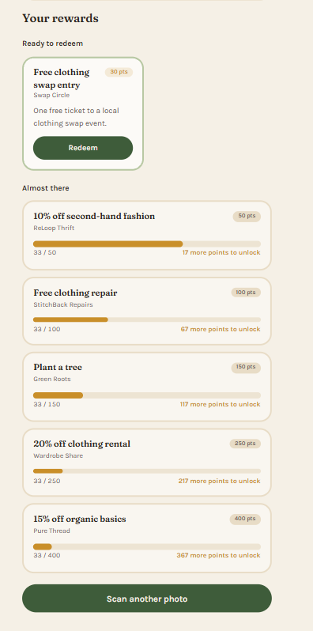

# 🌍 EcoScan - Clothing Carbon Footprint Scanner

EcoScan lets you snap or upload a photo of your clothes, identifies each item,
estimates its carbon footprint, rewards eco-friendly choices with points, and
shows offers you can unlock with those points.

> ✅ Complete: backend and frontend are done and tested. Not deployed: run it locally (see [Quick start](#-quick-start)).

## Contents
- [Tech stack](#-tech-stack)
- [Quick start](#-quick-start)
- [Backend setup](#-backend-setup)
- [Image recognition (Gemini, OpenAI or mock)](#-image-recognition)
- [Frontend setup](#-frontend-setup)
- [Running the tests](#-running-the-tests)
- [API reference](#-api-reference)
- [Carbon footprint assumptions](#-carbon-footprint-assumptions)
- [Eco tips](#-eco-tips)
- [Code structure](#-code-structure)
- [Frontend](#-frontend)
- [Deployment](#-deployment)
- [Enhancements](#-enhancements)

## 🔧 Tech stack
- **Backend**: Python 3.10+, FastAPI, Pydantic
- **Image recognition**: Google Gemini (free tier, default `gemini-3.8-flash`) or an OpenAI vision model (default `gpt-4o-mini`), with a mock provider for development and tests
- **Frontend**: React 19 + TypeScript, Vite, Tailwind CSS v4
- **Tests**: pytest (backend), Vitest + React Testing Library (frontend)

## ⚡ Quick start

You need **Python 3.10+** and **Node.js 20.19+** (22.22+ or 24.15+ to run the
frontend tests). Both ways below run on the mock vision provider by default,
without an API key.

### Quick run (one server)

Build the frontend once, then FastAPI serves the whole app (the page and the API) from one port:

```bash
cd frontend && npm install && npm run build
cd ../backend
# first time only: create and activate a venv, then (see Backend setup)
#   pip install -r requirements.txt
#   copy .env.example .env    (macOS / Linux: cp .env.example .env)
uvicorn app.main:app
```

Then open **http://localhost:8000**. The app calls `/api` on the same server, so
there is nothing to configure and no CORS. If `frontend/dist` does not exist, the
backend serves only the API and logs a hint to run `npm run build`. Rebuild after
changing frontend code.

### Development (two terminals)

For hot reload while you change code, run the backend and the Vite dev server
in two terminals, from the repo root:

| Terminal 1: backend | Terminal 2: frontend |
|---|---|
| `cd backend` | `cd frontend` |
| create and activate a venv ([details](#-backend-setup)) | `npm install` |
| `pip install -r requirements.txt` | `npm run dev` |
| `copy .env.example .env` (Windows) or `cp .env.example .env` | |
| `uvicorn app.main:app --reload` | |

Then open **http://localhost:5173**. The frontend sends `/api` requests to the
backend on port 8000 through the Vite dev proxy, so no extra setup is needed.

### Local URLs

| URL | What |
|---|---|
| http://localhost:8000 | The EcoScan app in one-server mode (after `npm run build`) |
| http://localhost:5173 | The EcoScan app in development mode (Vite dev server) |
| http://localhost:8000/docs | Interactive API docs (Swagger): try every endpoint in the browser |
| http://localhost:8000/api/health | Health check, returns `{"status": "ok"}` |

## 🚀 Backend setup

Run backend commands from the `backend/` folder (that is where `pytest.ini` is read from).
Settings always come from `backend/.env`, whatever folder uvicorn is started from. At startup
the terminal shows which vision provider is active, e.g.
`INFO: Vision provider: gemini (model gemini-3.8-flash). Settings from …/backend/.env.`
Restart the backend after editing `.env`: settings are read once, at startup.

**Windows (PowerShell)**
```powershell
cd backend
python -m venv .venv
.venv\Scripts\Activate.ps1
pip install -r requirements.txt
copy .env.example .env
uvicorn app.main:app --reload
```
If PowerShell blocks the activate script, run `Set-ExecutionPolicy -Scope CurrentUser RemoteSigned` once.

**macOS / Linux**
```bash
cd backend
python3 -m venv .venv
source .venv/bin/activate
pip install -r requirements.txt
cp .env.example .env
uvicorn app.main:app --reload
```

The default `.env` uses the **mock** vision provider, so the app runs without an API key.

### Environment variables (`backend/.env`)

| Variable | Default | What it does |
|---|---|---|
| `VISION_PROVIDER` | `mock` | `mock` (no key, predictable demo results), `openai` or `gemini` |
| `OPENAI_API_KEY` | *(empty)* | Required when `VISION_PROVIDER=openai`. Never commit it. |
| `OPENAI_MODEL` | `gpt-4o-mini` | Any OpenAI model that accepts images and JSON mode |
| `OPENAI_TIMEOUT_SECONDS` | `30` | Timeout for one OpenAI request |
| `GEMINI_API_KEY` | *(empty)* | Required when `VISION_PROVIDER=gemini`. Get a free key in [Google AI Studio](https://aistudio.google.com/apikey). Never commit it. |
| `GEMINI_MODEL` | `gemini-3.8-flash` | Any Gemini model that accepts images and JSON output, e.g. the lighter `gemini-3.5-flash-lite` |
| `GEMINI_TIMEOUT_SECONDS` | `30` | Timeout for one Gemini request |
| `MAX_IMAGE_MB` | `10` | Largest upload accepted (a safety net: the web app sends resized JPEGs, usually under 1 MB) |
| `POINTS_PER_KG` | `10` | Reward points per kg of CO2e saved |
| `CORS_ORIGINS` | `http://localhost:5173` | Comma-separated origins allowed to call the API (the Vite dev server) |

## 🔍 Image recognition

The backend reads photos with one of three **vision providers**, chosen with
`VISION_PROVIDER` in `backend/.env`:

| Provider | Key needed | Cost | What you get |
|---|---|---|---|
| `mock` (default) | No | Free | Sample results: one of a few fixed outfits, whatever the photo shows. The app shows a **"Demo mode"** banner. |
| `gemini` | Yes, free | Free tier (daily request limits) | Real recognition of every item in the photo |
| `openai` | Yes | Paid per request | Real recognition of every item in the photo |

### Get a free Gemini key

1. Go to [Google AI Studio](https://aistudio.google.com/apikey) and sign in with a Google account.
2. Click **Create API key** and copy it.
3. Put it in `backend/.env` (below) and restart the backend.

The free tier needs no billing account, but it has daily and per-minute request
limits (see [Gemini rate limits](https://ai.google.dev/gemini-api/docs/rate-limits)).
When a limit is hit, the scan fails with a friendly "try again" message (`502 vision_service_error`).
**If scans fail,** the backend terminal shows the real reason (never the key), e.g.
`WARNING: Gemini request failed: ClientError: 400 INVALID_ARGUMENT ... API key not valid`.

### `.env` settings

**Gemini (free):**
```env
VISION_PROVIDER=gemini
GEMINI_API_KEY=your-key-here
# Optional: GEMINI_MODEL=gemini-3.8-flash (or gemini-3.5-flash-lite), GEMINI_TIMEOUT_SECONDS=30
```

**OpenAI:**
```env
VISION_PROVIDER=openai
OPENAI_API_KEY=your-key-here
# Optional: OPENAI_MODEL=gpt-4o-mini, OPENAI_TIMEOUT_SECONDS=30
```

**Mock (no key, the default):**
```env
VISION_PROVIDER=mock
```

`backend/.env` is in `.gitignore`, so your key is never committed. Only
`.env.example`, with empty keys, is in the repo. If a provider is selected
without its key, the backend still starts but logs a warning
(`VISION_PROVIDER=gemini but GEMINI_API_KEY is empty: scans will fail.`), and
scans fail with a `500`.

### How a scan works

1. The browser resizes the photo to a JPEG (max 1600 px) and uploads it.
2. The backend checks the file (type, size, real image bytes).
3. The provider sends the photo with **one shared prompt**
   (`backend/app/services/vision/prompt.py`), used by both Gemini and OpenAI. It
   lists every known category from the [carbon table](#base-footprint-per-new-item-kg-co2e)
   and asks the model to:
   - detect **every** clothing item, shoe and accessory in the photo
   - use a known category when it fits, otherwise a short generic name
   - guess the material, or say `"unknown"`
   - give a confidence (0–1) and a short **label**, e.g. "red floral midi dress"
   - reply with JSON only
4. The reply is checked with Pydantic. Invalid items are skipped, and a broken
   reply, an API error or a timeout becomes a clean `502`.
   **Every item starts as `"new"`**: a photo can't show how an item was bought,
   so the model isn't asked to guess. The user marks second-hand items with the
   chips on each card.
5. Each item gets its carbon footprint, points and an [eco tip](#-eco-tips).

The response's `provider` field says which provider read the photo. The app
shows the label as each item's title, with the category underneath.

## 🎨 Frontend setup

Needs **Node.js 20.19+** to install, run and build the app (Vite's minimum).
The tests need **22.22+ or 24.15+**, the minimum versions Vitest and jsdom support.

```bash
cd frontend
npm install
npm run dev
```

The app opens at http://localhost:5173. Start the backend too (see [Quick start](#-quick-start)).

| Command | What it does |
|---|---|
| `npm run dev` | Dev server with hot reload, proxies `/api` to `http://localhost:8000` |
| `npm test` | Runs the tests once (`npm run test:watch` re-runs them on save) |
| `npm run build` | Type-checks (including tests) and builds to `frontend/dist` |
| `npm run lint` | Lints with oxlint |
| `npm run preview` | Serves the production build locally |

### Environment variables (`frontend/.env`, optional)

| Variable | Default | What it does |
|---|---|---|
| `VITE_API_URL` | `/api` | Where the app sends API requests. Leave it empty locally. Set it when the backend is deployed elsewhere, e.g. `https://ecoscan-api.example.com/api` |

**Trying it on your phone:** run `npm run dev -- --host` and open the "Network"
URL it prints on your phone (same Wi-Fi). "Take photo" uses the phone's own
camera app, so it works over plain HTTP. The desktop webcam view needs
`localhost` or HTTPS, as browsers require for camera access.

## 🧪 Running the tests

**Backend** (314 tests)
```bash
cd backend
pytest
```
> **Tests never call real APIs and need no keys.** The Gemini and OpenAI
> providers are tested with fake clients that return canned replies or raise
> errors. API tests replace the vision provider and settings through FastAPI's
> `dependency_overrides`, and ignore your local `.env`. The suite passes with
> outgoing network access blocked, so it is free, fast and works offline.

**Frontend** (55 tests)
```bash
cd frontend
npm test
```
Tests run in jsdom with React Testing Library. `fetch` and the API client are
mocked, so the backend does not need to be running. They cover client-side file
checks, resizing photos before upload, API error parsing, the results summary,
item cards (label, eco tip, the New / Second-hand chips and rescoring), the
demo-mode banner, offers (including redeeming and the zero-points message) and
editing items before recalculating.

## 📡 API reference

All endpoints are under `/api`.

| Method | Path | Input | Output | Error codes |
|---|---|---|---|---|
| `GET` | `/api/health` | none | `{"status": "ok"}` | none |
| `POST` | `/api/analyze` | multipart form, field `file`: JPEG, PNG or WebP, max 10 MB | Items with carbon, points and a tip, totals, offers, and the `provider` that read the photo (`mock` = sample results) | `400 empty_image`, `413 image_too_large`, `415 invalid_image`, `422 no_clothing_detected`, `422 validation_error`, `502 vision_service_error` |
| `POST` | `/api/score` | JSON `{"items": [{"category", "material", "condition", "confidence", "label"}]}`, at least one item (only `category` is required) | Items with carbon, points and a tip, and totals | `422 validation_error` |
| `GET` | `/api/offers?points=<int ≥ 0>` | Query `points` | `{"points", "eligible": [...], "locked": [... with points_needed]}` | `422 validation_error` |
| `GET` | `/api/carbon-factors` | none | The carbon tables below, as JSON | none |

`/api/score` exists so the user can correct what the scan detected (e.g. mark an
item as second-hand) and get a new score without uploading the photo again.

**Every error has the same shape**, so the frontend only needs to read `error.code`:
```json
{"error": {"code": "image_too_large", "message": "The image is too large. The limit is 10 MB."}}
```
Validation errors also include a `details` list showing which field is wrong.

**Image checks** for `/api/analyze`, in order: allowed content type → not empty →
within the size limit → the file's first bytes really are a JPEG, PNG or WebP
(so a `.txt` renamed to `.png` is rejected).

**The web app resizes photos before upload.** It accepts any image the browser
can decode (including HEIC on Safari), scales it so the longest side is at most
1600 px (never up), keeps the EXIF orientation, and uploads a JPEG at quality
0.85. A typical phone photo ends up well under 1 MB, so the API's size limit is
only a safety net. Originals over 30 MB are refused in the browser.

<details>
<summary>Example <code>/api/analyze</code> response (lists shortened)</summary>

A fresh scan: every item starts as `"new"`, so nothing is saved yet and the tip
says what marking it second-hand would earn.

```json
{
  "items": [
    {"category": "jeans", "material": "cotton", "condition": "new", "confidence": 0.91,
     "label": "faded blue straight-leg jeans",
     "baseline_kg": 10.0, "actual_kg": 10.0, "saved_kg": 0.0, "points": 0,
     "tip": "Bought second-hand, this would save 8 kg CO2 (+80 pts). Organic cotton would save about 3 kg."}
  ],
  "total_carbon_kg": 10.0,
  "total_saved_kg": 0.0,
  "total_points": 0,
  "offers": {
    "points": 0,
    "eligible": [],
    "locked": [{"id": "swap-pass", "title": "Free clothing swap entry", "partner": "Swap Circle",
                "description": "...", "points_required": 30, "points_needed": 30}]
  },
  "provider": "gemini"
}
```

After the user marks the jeans second-hand, `/api/score` returns `"actual_kg": 2.0`,
`"saved_kg": 8.0`, `"points": 80` and the tip "Great choice! Buying it second-hand saved about 8 kg of CO2."
</details>

## 🌱 Carbon footprint assumptions

> ⚠️ **These numbers are illustrative estimates for a demo, not audited
> life-cycle data.** They are in the right range for the brief's examples
> (T-shirt = 5 kg, Jeans = 10 kg) and are easy to replace (see [Code structure](#-code-structure)).

### Formula
```
baseline_kg = base_kg[category]                          the same item bought new, in a conventional material
actual_kg   = base_kg × material_factor × condition_factor
saved_kg    = baseline_kg − actual_kg                    never below 0
points      = saved_kg × 10                              rounded half up, per item (POINTS_PER_KG)
```

**Why reward savings, not low totals?** Most of a garment's footprint comes from
producing it: growing or making the fibre, dyeing and manufacturing. Buying
second-hand avoids almost all of that, and lower-impact materials avoid part of it.
Points reward the choice the user made compared with buying the same item new.

**Example:** cotton jeans marked second-hand → `10 × 1.0 × 0.2 = 2 kg`, saved `10 − 2 = 8 kg` → **80 points**.
Organic cotton jeans bought new → `10 × 0.7 × 1.0 = 7 kg`, saved `3 kg` → **30 points**.

A higher-impact material (e.g. wool, factor 1.3) raises `actual_kg` but never gives negative savings or points.

### Base footprint per new item (kg CO2e)

| Group | Category (kg) |
|---|---|
| Tops | t-shirt 5 · shirt 6 · top 5 · crop top 4 · tank top 3 · sweater 12 · hoodie 11 |
| Bottoms | jeans 10 · trousers 9 · shorts 4 · skirt 6 · leggings 4 |
| One-piece and sets | dress 9 · tracksuit 14 · swimwear 3 · underwear 1.5 |
| Outerwear | jacket 15 · coat 20 · blazer 14 |
| Indian wear | saree 14 · kurta 7 · kurti 6 · lehenga 25 · salwar 6 · dupatta 4 · sherwani 20 |
| Footwear | shoes 8 · sneakers 14 · boots 16 · sandals 5 |
| Accessories | socks 1 · hat 2 · cap 1.5 · scarf 3 · gloves 2 · tie 1.5 · belt 3 · bag 8 |
| *Anything else* | **7** (default) |

Common synonyms are mapped to these categories, e.g. tee → t-shirt, denim → jeans,
trainers → sneakers, parka → coat, sari → saree, salwar kameez → salwar,
flip flops → sandals, jumper / cardigan → sweater. The longest matching name
wins, so "crop top" is not read as "top" and "yoga pants" is not read as "pants".

### Material factors (× base)

| Material | Factor | | Material | Factor |
|---|---|---|---|---|
| recycled cotton | 0.5 | | cotton | 1.0 |
| recycled polyester | 0.6 | | polyester | 1.0 |
| hemp | 0.6 | | nylon | 1.1 |
| organic cotton | 0.7 | | acrylic | 1.1 |
| lyocell / tencel | 0.7 | | wool | 1.3 |
| linen | 0.8 | | leather | 1.5 |
| | | | *unknown* | **1.0** |

The most specific match wins: "organic cotton" uses 0.7, not cotton's 1.0.

### Condition factors (× base)

| Condition | Factor | Why |
|---|---|---|
| new | 1.0 | Full production impact |
| second-hand | 0.2 | Assumes reuse avoids about 80% of the impact. The remaining 0.2 stands for shipping, washing and the item's share of its first life. |

**The condition comes from the user, not the photo.** A photo can't prove an item
was bought second-hand, so every scanned item starts as `new` (factor 1.0, nothing
saved). Each item card has **New / Second-hand** chips: choosing Second-hand
rescores the item with factor 0.2 and adds its points. `/api/score` also accepts
"used", "thrifted", "vintage" and "pre-owned" as second-hand.

The live values are always available at `GET /api/carbon-factors`. The category
list is also sent to the vision model, so it picks names this table knows.

## 🌿 Eco tips

Every scored item gets one short, friendly tip. Tips are **rule-based**, not
AI-generated, so they are free, instant and easy to test. The rules live in one
place, `TIP_RULES` in `backend/app/services/tips.py`, and are checked in order:
the first rule that applies writes the tip.

| # | Rule | When | Example |
|---|---|---|---|
| 1 | Second-hand | The user marked the item second-hand | "Great choice! Buying it second-hand saved about 8 kg of CO2." |
| 2 | Low-impact material | New, material factor below 1 (organic cotton, linen, hemp…) | "Nice pick! Organic cotton saved about 1.5 kg of CO2 compared with a conventional material." |
| 3 | Would save second-hand | Everything else: new, nothing saved (always applies) | "Bought second-hand, this would save 8 kg CO2 (+80 pts). Organic cotton would save about 3 kg." |

Rule 3 leads with what second-hand would save, because a photo can't show how an
item was bought and users can mark it on the item card. It then adds care advice
for a high-impact material ("Wool has a higher footprint, so make it last: …"), or
a lower-impact alternative (cotton → organic cotton, polyester → recycled polyester).
Its kg and points are worked out by the carbon and rewards services: the same item
is scored again as second-hand, so they always match the tables above.

**Adding a tip:** add a `TipRule(name, applies, tip)` at the right place in
`TIP_RULES`. Care advice per material is in `CARE_TIPS`, and material swaps are
in `MATERIAL_ALTERNATIVES`.

## 🏗️ Code structure

```
backend/
├── app/
│   ├── main.py              create_app(): CORS, error handlers, routes, serves frontend/dist if built
│   ├── config.py            all settings, read from .env
│   ├── schemas.py           all Pydantic models (request and response shapes)
│   ├── errors.py            custom errors → {"error": {"code", "message"}}
│   ├── dependencies.py      wires repositories and services together
│   ├── api/routes.py        HTTP only: validate, call a service, return a schema
│   ├── services/            all business logic
│   │   ├── analysis.py          one scan: validate → detect (all items start new) → score → offers
│   │   ├── image_validation.py  type, size and file-signature checks
│   │   ├── carbon.py            carbon per item
│   │   ├── rewards.py           saved kg → points
│   │   ├── scoring.py           carbon + rewards + tips → totals
│   │   ├── tips.py              one rule-based eco tip per item
│   │   ├── offers.py            eligible and locked offers
│   │   └── vision/              VisionProvider interface, mock, OpenAI and Gemini providers, shared prompt
│   └── data/                in-memory data behind repository interfaces
│       ├── carbon_factors.py    the carbon tables above
│       └── offers.py            demo offers
└── tests/                   unit tests per service + API tests
```

| Layer | Knows about | Does not know about |
|---|---|---|
| **routes** | HTTP, requests, responses | how anything is calculated |
| **services** | the business rules | HTTP, or where data is stored |
| **data** | the stored values | how they are used |
| **schemas** | the shape of every piece of data | everything else |

**Why it is built this way:**
- **Swap the data source easily.** Services read carbon factors and offers through
  small repository interfaces (`CarbonFactorRepository`, `OfferRepository`). To use
  a database or a live carbon API, write one new class with the same methods and
  change one line in `dependencies.py`. The carbon logic does not change.
- **Swap the AI model easily.** Everything depends on the `VisionProvider`
  interface (`detect_items(image, content_type) -> list[DetectedItem]`). Changing
  model means a new class plus one entry in `PROVIDERS`, chosen with `VISION_PROVIDER`.
- **The model only reports what a photo can show.** It names the item, material and
  label; it is not asked how the item was bought. Every item starts as new and the
  user chooses second-hand, so points come from the user's real choices, not a guess.
- **Model output is never trusted blindly.** Both the OpenAI and Gemini providers send
  the same prompt (`vision/prompt.py`), and the reply must be JSON checked with Pydantic.
  Invalid items are skipped, and a broken reply becomes a clean `502`.
- **Easy to test.** Services get their dependencies through `__init__`, so tests
  pass in fakes. API tests swap dependencies with `dependency_overrides`.
- **No database**, as the brief requires: all data lives in memory.

## 🖥️ Frontend

A mobile-first single page: most people will scan clothes with a phone camera.

### Screenshots

| Upload | Results | Offers |
|---|---|---|
|  |  |  |
| Take or choose a photo of your clothes. | Totals, then one card per item with its footprint, points and an eco tip. The banner shows these are sample results from the mock provider. | Offers ready to redeem, and how many more points unlock the rest. |

_The results and offers screenshots were taken before the New / Second-hand chips
were added: today each card also asks "How did you get it?", and a fresh scan
starts with every item on New._

### User flow
1. **Add a photo**: drag and drop, "Choose photo", or "Take photo" (the phone's
   camera, or a webcam view on desktop). The file type and size are checked
   before uploading.
2. **Scan**: a friendly loading message while the backend analyses the photo. The scan can be cancelled.
3. **Results**: totals for carbon, CO2 saved and points, then one card per item:
   its label (e.g. "Red floral midi dress"), its footprint compared with buying it
   new, and an eco tip. Sample results from the mock provider show a "Demo mode" banner.
4. **"How did you get it?"**: a photo can't show whether an item was bought
   second-hand, so every item starts on **New**, with **New / Second-hand** chips
   on each card. Changing one rescores right away (`/api/score` and `/api/offers`),
   with a small "Updating…" state, and updates the item, the totals and the offers.
5. **Fix mistakes**: "Edit items" changes an item's type, material or condition,
   or removes it, then recalculates.
6. **Rewards**: offers ready to redeem, and progress bars for the rest. With no
   points yet, a friendly nudge and the nearest reward instead of an empty list.

Every backend error code has its own message, with "Try again" only where a retry can help.

### Frontend structure

```
frontend/src/
├── api/                 the only code that talks to the backend
│   ├── config.ts            API_BASE from VITE_API_URL (default "/api")
│   ├── types.ts             TypeScript versions of the backend schemas
│   ├── client.ts            analyzeImage, scoreItems, getOffers, getCarbonFactors + ApiError
│   └── rescore.ts           score edited items again + fetch offers (chips and Edit items)
├── components/          small components, one job each
│   ├── ScanPanel.tsx        photo → preview → scan, with loading and errors
│   ├── PhotoPicker.tsx      drag and drop, choose photo, take photo
│   ├── CameraModal.tsx      desktop webcam capture
│   ├── ResultsView.tsx      summary, items, edit mode and offers
│   ├── EditItemsPanel.tsx   edit or remove items, then recalculate
│   ├── OffersSection.tsx    ready to redeem and almost there
│   └── ...                  item card with New / Second-hand chips, bars, toast, error notice
├── lib/                 plain helpers: file checks, formatting, error wording
├── test/                test setup and shared fixtures
├── App.tsx              switches between the scan screen and the results
└── index.css            Tailwind and the design tokens
```

**Design decisions:**
- **API calls only in `src/api`.** Components never call `fetch`. Every failure becomes one `ApiError` with a `code`, so the UI handles errors in one way.
- **Types mirror the backend schemas**, so a renamed field is caught when you build, not by a user.
- **Design tokens in one place.** Colours and fonts live in `@theme` in `index.css`.
  Colours have a meaning across the app: clay = CO2, fern and moss = savings, ochre = points.
- **The backend has the final word.** The client repeats the file checks only to give faster
  feedback. Carbon and points always come from the API.
- **Accessible by default.** Real buttons and labels, a native `<dialog>` for the
  camera, `role="progressbar"`, `role="alert"` and `role="status"` for live updates.
  Tests find elements the same way a screen reader would.

## ☁️ Deployment

**Not deployed: run it locally** (see [Quick start](#-quick-start) and [Backend setup](#-backend-setup)).

How it would deploy:
- **Backend on Render:** a Python web service with root directory `backend`, build command `pip install -r requirements.txt` and start command `uvicorn app.main:app --host 0.0.0.0 --port $PORT`. The [environment variables](#environment-variables-backendenv) are set in Render's dashboard (e.g. `VISION_PROVIDER=gemini` and `GEMINI_API_KEY`), never in the repo.
- **Frontend on Vercel:** root directory `frontend`, build command `npm run build`, output `dist`. Set `VITE_API_URL` to the backend's URL plus `/api` (e.g. `https://ecoscan-api.onrender.com/api`). It is read at build time, so redeploy after changing it.
- **CORS:** set the backend's `CORS_ORIGINS` to the frontend's URL (e.g. `https://ecoscan.vercel.app`), so the browser lets the app call the API.

## 💡 Enhancements

Each idea builds on seams that already exist in the code: the repository
interfaces in `backend/app/data/`, the `VisionProvider` interface and its
`PROVIDERS` registry, the wiring in `dependencies.py`, and settings in `config.py`.

### Technical Scaling

- **Run several API instances behind a load balancer.** The API keeps no per-user state in memory (the data is read-only), so any instance can serve any request. Once users and points exist, they must live in the database (below), not in memory.
  *Why:* scale out by adding instances, with no sticky sessions.
- **Cache vision results by image hash (Redis).** Add a `CachingVisionProvider` that wraps the real provider: it looks up the SHA-256 of the image (plus model and prompt version) and calls the vision model only on a miss. Register it in `PROVIDERS`; routes and services do not change. Cache carbon factors too once they come from a database or API (today `get_carbon_factors` is an in-process `lru_cache`).
  *Why:* the same photo never uses up a second model call (or free-tier quota), and repeat scans become instant.
- **Move vision calls to a background queue.** `POST /api/analyze` returns `202` with a job id, a worker (e.g. Celery, RQ or arq) runs the `AnalysisService`, and the app polls `GET /api/analyze/{job_id}`. Keep the provider timeouts (`GEMINI_TIMEOUT_SECONDS`, `OPENAI_TIMEOUT_SECONDS`) and add retries with backoff for `429` and `5xx` only.
  *Why:* slow model calls no longer tie up web workers, and spikes queue up instead of failing.
- **Postgres behind the existing repositories.** Write `PostgresCarbonFactors` and `PostgresOffers` with the same methods as `CarbonFactorRepository` and `OfferRepository`, swap them in `dependencies.py`, and add tables for users and an append-only **points ledger**. Keep images in object storage (e.g. S3) with a short retention period, or do not store them at all.
  *Why:* factors and offers can change without a deploy, and redeeming can really deduct points.
- **Protect and observe the API.** Add rate limiting per user and IP, strictest on `/api/analyze` because every call uses paid or rate-limited model requests. Add structured JSON logs with a request id, metrics (scan latency, vision error rate, cost per scan), error tracking (e.g. Sentry) on both apps, and CI that runs `pytest` and `npm test` on every push.
  *Why:* limits control cost and abuse, monitoring finds problems before users report them, and CI keeps `main` green.

### Product Improvements

- **A better carbon model.** Add material mix (e.g. 60% cotton and 40% polyester), garment weight or size, country of manufacture, brand data and expected lifetime (cost-per-wear: footprint ÷ expected wears), plus washing impact. Make garment condition richer than new / second-hand: "like new", "worn", "repaired" or "upcycled" each extend an item's life by a different amount, and a repair could earn points too. Show a range (e.g. 4–7 kg) instead of one number. This extends `DetectedItem` and `CarbonFactorRepository`, and `CarbonService` keeps doing the maths.
  *Why:* one number per category hides most of the real difference between garments, and a range is more honest.
- **Real data through APIs.** Use an emission-factor API (e.g. Climatiq) behind `CarbonFactorRepository`, with a cache and the in-memory tables as a fallback. Use brand or retailer product data for materials and weights. Use partner offer APIs behind `OfferRepository`, so that "Redeem" returns a real code.
  *Why:* numbers and offers stay current without code changes.
- **Read the care label.** Add an optional second photo of the label. Its text (OCR, or the vision model) gives the exact materials and percentages.
  *Why:* the label is far more accurate than guessing the material from a photo.
- **Make the impact tangible and keep users coming back.**
  - Comparisons such as "8 kg CO2 saved ≈ N km not driven".
  - A wardrobe history across scans.
  - Streaks and badges.
  - A shareable scan card.
  - Accounts with a points history, built on the points ledger.

  *Why:* kilograms of CO2 are abstract, and progress over time is what changes habits.
- **Learn from user corrections.** Users can already mark items second-hand with the chips and fix items with "Edit items" (both → `/api/score`). With consent, log the detected item next to the corrected one. Use these pairs to measure accuracy, add missing words to `CATEGORY_ALIASES`, tune the prompt, and later fine-tune a model.
  *Why:* every correction becomes free training and evaluation data.
