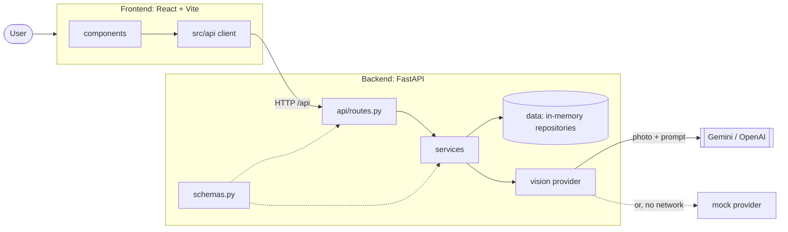

# EcoScan architecture

How the app is put together and how a request flows through it. For setup and
the full carbon tables, see the [README](../README.md). For request and
response examples, see [API.md](API.md).

## Overview



| Part | What it does |
|---|---|
| **Frontend** (`frontend/`) | React + TypeScript single page. Takes or picks a photo, resizes it to a JPEG (longest side 1600 px) and uploads it. Shows items, totals, tips and offers. Only `src/api/` talks to the backend. |
| **Backend** (`backend/`) | FastAPI app under `/api`. Validates the image, asks the vision provider what is in it, then calculates carbon, points, tips and offers. Can also serve the built frontend from `/`. |
| **Vision provider** | Turns image bytes into a list of `DetectedItem`s. `gemini` and `openai` call a real model with one shared prompt. `mock` returns fixed outfits with no key or network. Chosen with `VISION_PROVIDER`. |

There is no database: carbon factors and offers live in memory.

## Backend layers

| Layer | Files | Job | Why it is separate |
|---|---|---|---|
| **routes** | `api/routes.py` | HTTP only: read the request, call one service, return a schema | Routes stay thin, so all logic can be tested without HTTP. |
| **services** | `services/` | All business rules: image checks, scan flow, carbon, points, tips, offers, vision | They get dependencies through `__init__`, so tests pass in fakes. They raise `EcoScanError`s, not HTTP errors. |
| **data** | `data/` | Carbon factors and offers behind small `Protocol` interfaces (`CarbonFactorRepository`, `OfferRepository`) with in-memory implementations | A database or external API can replace them by writing one class; services do not change. |
| **schemas** | `schemas.py` | Every Pydantic model: requests, responses, items, offers | One source of truth for data shapes. FastAPI uses them to validate input and document `/docs`. |

Supporting files:

- `dependencies.py` wires the layers together, and is the only place that does.
  Repositories and the vision provider are built once per process (`lru_cache`).
  Services are built per request.
- `config.py` reads every setting from `backend/.env`.
- `errors.py` defines the error classes and turns them into one JSON shape.
- `services/vision/factory.py` maps `VISION_PROVIDER` to a provider class (`PROVIDERS`).

## Flow of one scan (`POST /api/analyze`)

1. **Frontend:** `ScanPanel` checks the file, resizes it to a JPEG and calls
   `analyzeImage()` in `src/api/client.ts`, which posts it as multipart field `file`.
2. **Route:** `analyze()` reads at most `MAX_IMAGE_MB` + 1 byte (enough to tell
   that a file is too large without loading all of it) and calls
   `AnalysisService.analyze(bytes, content_type)`.
3. **Validate** (`image_validation.py`), in order: the declared type is JPEG, PNG
   or WebP → the file is not empty → it is within the size limit → its first bytes
   really are that kind of image. The real type is passed on.
4. **Detect:** `VisionProvider.detect_items()`. Real providers send the image with
   the shared system prompt (`vision/prompt.py`), which lists the known
   categories and asks for JSON only. The reply is parsed with Pydantic, and
   invalid items are skipped. An API error, timeout, empty or unreadable reply
   raises `VisionServiceError` (502).
5. **No items** → `NoClothingDetectedError` (422).
6. **Reset condition:** every item is set to `"new"`. A photo can't show how an
   item was bought, so the user decides that later.
7. **Score** (`ScoringService`): for each item `CarbonService` gives baseline,
   actual and saved kg (and a canonical category name, e.g. "denim" → "jeans"),
   `RewardsService` turns saved kg into points, and `EcoTipService` picks a tip.
   Totals are the sums of the items.
8. **Offers** (`OffersService`): offers sorted by cost, split into `eligible` and
   `locked`, each locked offer with `points_needed`.
9. **Response:** `AnalysisResponse` = items + totals + offers + `provider`
   (the frontend shows a "Demo mode" banner when it is `mock`).

## Flow of a rescore (`POST /api/score` + `GET /api/offers`)

Used when the user taps **New / Second-hand** on an item card, or saves changes
in **Edit items**. The photo is not sent again.

1. **Frontend:** `rescore()` in `src/api/rescore.ts` strips each item back to
   what was detected (`category`, `material`, `condition`, `confidence`, `label`)
   with the user's changes, and calls `scoreItems()`.
2. **Backend:** `/api/score` validates the list (at least one item; condition
   words like "used" or "thrifted" become `"second-hand"`) and runs the same
   `ScoringService` as a scan. No vision call, no image checks.
3. **Frontend:** calls `getOffers(total_points)` for the new balance, then
   replaces items, totals and offers. It keeps the original `provider`.

## Carbon formula

```
baseline_kg = base_kg[category]                   new item, conventional material
actual_kg   = baseline_kg × material_factor × condition_factor
saved_kg    = max(baseline_kg − actual_kg, 0)
points      = round_half_up(saved_kg × POINTS_PER_KG)   per item, POINTS_PER_KG = 10
```

- Unknown category → 7 kg. Unknown material → factor 1.0.
- Category and material use the longest matching name, so "organic cotton"
  is 0.7, not cotton's 1.0, and "crop top" is not read as "top".
- Condition: `new` = 1.0, `second-hand` = 0.2.
- A higher-impact material (wool 1.3, leather 1.5) raises `actual_kg` but never
  gives negative savings or points.

**Worked example:** cotton jeans, marked second-hand.

| Step | Value |
|---|---|
| `baseline_kg` | jeans = **10.0** |
| `material_factor` | cotton = 1.0 |
| `condition_factor` | second-hand = 0.2 |
| `actual_kg` | 10.0 × 1.0 × 0.2 = **2.0** |
| `saved_kg` | 10.0 − 2.0 = **8.0** |
| `points` | 8.0 × 10 = **80** |

The same jeans straight after a scan (condition `new`): actual 10.0, saved 0,
0 points. The full tables are in the README and at `GET /api/carbon-factors`.

## Error codes

Every error has the same body: `{"error": {"code": "...", "message": "..."}}`.
Services raise subclasses of `EcoScanError` (`errors.py`), and one handler turns
them into that body.

| Status | Code | When |
|---|---|---|
| 400 | `empty_image` | The uploaded file has no bytes |
| 413 | `image_too_large` | Larger than `MAX_IMAGE_MB` (default 10) |
| 415 | `invalid_image` | Declared type is not JPEG/PNG/WebP, or the bytes are not a real image |
| 422 | `no_clothing_detected` | The vision provider found no items |
| 422 | `validation_error` | Request does not match the schema; includes a `details` list |
| 502 | `vision_service_error` | Model API error, timeout, rate limit, or an empty or unreadable reply |

The frontend adds two codes of its own: `network_error` (server unreachable) and
`http_error` / `invalid_response` (a reply not in the shape above).

## How tests avoid real AI calls

- **API tests** replace dependencies with FastAPI's `app.dependency_overrides`:
  `get_vision_provider` → `MockVisionProvider` (or a small fake), and
  `get_settings` → `Settings(_env_file=None)`, so a local `.env` with a real key
  is never read.
- **`MockVisionProvider`** picks one of three fixed outfits from a SHA-256 hash
  of the image, so the same test image always gives the same items.
- **Gemini and OpenAI providers** are tested with fake clients passed to their
  constructors. The fakes return canned replies (valid JSON, code-fenced JSON,
  bad items, empty text) or raise the SDK's errors and `httpx` timeouts, to check
  each becomes the right result or `VisionServiceError`.
- **Services** are unit-tested directly with in-memory repositories.
- **Frontend tests** (Vitest + jsdom) mock `fetch` and the API client, so no
  backend is needed.

No test needs an API key or network access.
